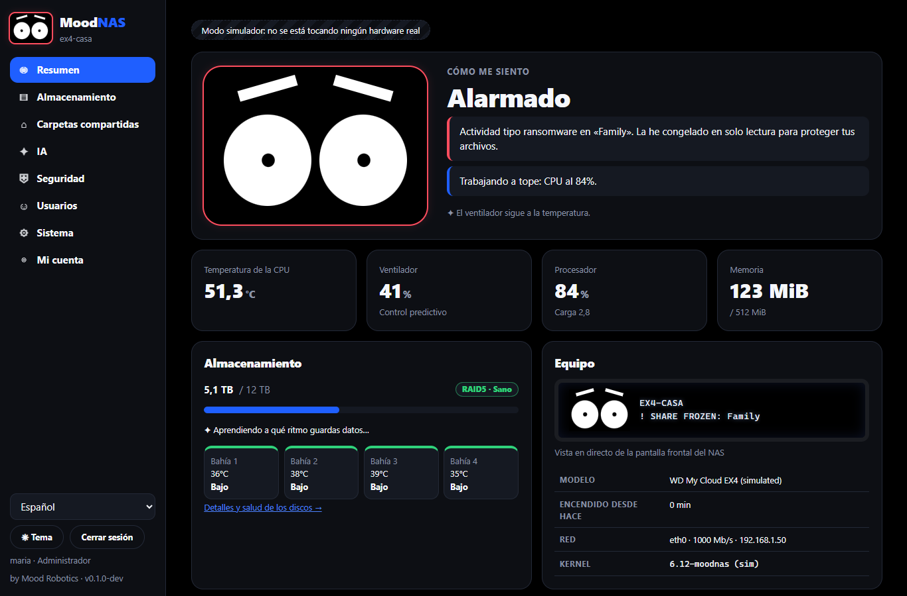

<p align="center">
  
</p>

<h1 align="center">MoodNAS</h1>

<p align="center">
  <strong>Un nuevo firmware de código abierto que da una segunda vida al WD My Cloud EX4.<br>
  Hardware antiguo, seguridad moderna, inteligencia artificial integrada.</strong>
</p>

<p align="center">
  <a href="README.md">English</a> ·
  <b>Español</b> ·
  <a href="README.pt.md">Português</a> ·
  <a href="README.fr.md">Français</a> ·
  <a href="README.de.md">Deutsch</a> ·
  <a href="README.it.md">Italiano</a> ·
  <a href="README.zh-CN.md">简体中文</a> ·
  <a href="README.ja.md">日本語</a>
</p>

<p align="center">
  
  
  
</p>

---

## Por qué

El **WD My Cloud EX4** es un NAS sólido de 4 bahías que Western Digital ya
no mantiene. Su último firmware usa Linux 3.2 (2013), OpenSSL 1.0.1 y PHP 5.4,
y trae una contraseña de root por defecto. Miles de estos equipos siguen
guardando fotos familiares y archivos de pequeñas empresas en redes cada vez
más hostiles.

**MoodNAS** sustituye ese firmware por un sistema moderno y abierto.
Aprovecha todo el hardware y le añade algo que nadie esperaba de una vieja
máquina ARM: **inteligencia artificial que protege tus datos**.

<p align="center">
  
</p>

## Lo más destacado

### 👀 Un NAS con estado de ánimo
Los ojos de Mood Robotics son la cara de MoodNAS:

- **tranquilo** cuando todo va bien;
- **concentrado** cuando trabaja;
- **descansando** por la noche;
- **preocupado** cuando algo necesita tu atención;
- **alarmado**, con un halo rojo, cuando tus datos están en peligro.

Los mismos ojos aparecen en la **pantalla OLED frontal**, así que ves cómo
está desde el otro lado de la habitación.

### 🧠 IA que funciona en el propio NAS
Estos modelos no necesitan la nube y no envían nada fuera de casa:

| | |
|---|---|
| **Predicción de fallos de disco** | Analiza los datos SMART de cada disco con un modelo basado en las estadísticas públicas de fallos de Backblaze. Te dice qué disco probablemente fallará, y por qué, antes de que ocurra. |
| **Centinela anti-ransomware** | Detecta el cifrado masivo de archivos (análisis de entropía y patrones de renombrado) y **congela la carpeta en solo lectura en segundos**. |
| **Ventilador predictivo** | Se anticipa al calor a partir de la tendencia de temperatura y guarda silencio por la noche, sin comprometer nunca la seguridad. |
| **Previsión de capacidad** | Aprende a qué ritmo guardas datos y avisa semanas antes de que se llene el volumen. |

### 💬 «Mood», tu asistente
Pregunta con tus palabras: *«¿Cómo está mi NAS?»*, *«¿Debería preocuparme
algún disco?»*, *«Crea una carpeta compartida llamada Fotos para todos»*.
Mood funciona con **Claude** (API de Anthropic) o con **Ollama en tu propia
red**, sin que nada salga de casa.

- Solo consulta lo que le muestran sus herramientas, y cualquier cambio espera
  a **tu confirmación**.
- Un **registro de privacidad** muestra cada petición que ha salido del NAS.

<p align="center">
  
</p>

### 🔒 Seguro desde el diseño
- **Sin contraseñas por defecto.** La configuración inicial exige un código de
  un solo uso que aparece en la pantalla frontal.
- **HTTPS por defecto.**
- **Contraseñas** con PBKDF2-SHA512, verificación en dos pasos (TOTP) y
  bloqueo tras intentos fallidos.
- **Protecciones web:** CSRF, Content-Security-Policy estricta y registro de
  auditoría.
- **Un único binario estático en Go** con el mínimo de dependencias.

Más detalles en [SECURITY.md](SECURITY.md).

### 🌍 En tu idioma
La interfaz y la documentación están en **español, inglés, portugués,
francés, alemán, italiano, chino y japonés**. Cada usuario elige el suyo.

### 💾 Tus datos se quedan donde están
MoodNAS lee **tal cual** los volúmenes RAID creados por el firmware de WD:
sin formatear y sin migrar.

## Estado

> **MoodNAS está en fase alfa.** La interfaz completa, la API, la IA local y
> el asistente funcionan hoy sobre un **EX4 simulado**. El siguiente hito es
> arrancar en el hardware real, y puedes ayudar.

| Fase | | Estado |
|---|---|---|
| 1 | Análisis del firmware y herramienta abierta `wdfw` (reempaquetado idéntico byte a byte) | ✅ hecho |
| 2 | Script de inventario del hardware (Stage 0, solo lectura) | ✅ listo; faltan informes de equipos reales |
| 3 | Interfaz web (8 idiomas), API, seguridad y simulador | ✅ hecho |
| 4 | IA en el equipo y asistente (Claude / Ollama) | ✅ primera versión |
| 4b | Alertas explicadas, búsqueda semántica y etiquetado de fotos | 🔜 planificado |
| 5 | Kernel *mainline* + Buildroot, arranque con kexec (sin escribir la flash) y driver del MCU | 🚧 en curso: *device tree* en borrador, protocolo del MCU descifrado |
| 6 | Instalación permanente | ⏳ requiere una vía de recuperación por consola serie |

## Pruébalo en dos minutos

Necesitas Docker:

```sh
git clone https://github.com/moodrobotics/moodnas-wd-mycloud-ex4.git
cd moodnas-wd-mycloud-ex4
docker compose up --build
```

1. Abre **http://localhost:8080**.
2. Entra con la cuenta de demostración **`demo`** / **`moodnas-demo`**.
3. En la página de resumen, prueba los escenarios del simulador: ola de calor,
   disco fallando, RAID degradado o ataque de ransomware. Fíjate en los ojos.

## Primer acceso y contraseñas

| Dónde | Usuario | Contraseña |
|---|---|---|
| Demo (`docker compose`, simulador) | `demo` | `moodnas-demo` |
| Tu NAS real | **ninguno por defecto** | **ninguna por defecto** |

En un NAS real **no hay usuario ni contraseña por defecto**, a propósito: el
firmware original de WD venía con una contraseña de root conocida, uno de los
puntos débiles que MoodNAS elimina. En el primer arranque:

1. El NAS muestra un **código de configuración** de 8 caracteres en su
   pantalla frontal (y en el registro del sistema).
2. Abre `https://<ip-del-nas>` e introduce el código. Así se demuestra que
   estás físicamente junto al NAS y nadie más en tu red puede apropiarse de él.
3. Crea **tu propio** administrador y contraseña (mínimo 10 caracteres).
   Después puedes activar la verificación en dos pasos en *Mi cuenta*.

La cuenta de demostración solo existe con `moodd -simulate -demo`. `moodd`
se niega a usar `-demo` en hardware real, porque su contraseña es pública.

¿Has olvidado la contraseña? Procedimiento de recuperación: ver
[docs/install](docs/install/README.md) (previsto con el port al hardware).

## Cómo funciona

```
Navegador (Svelte, 8 idiomas) ──HTTPS──▶ moodd (Go, un binario estático)
                                         ├─ API · autenticación · auditoría
                                         ├─ IA local: riesgo de disco · centinela · ventilador · previsión
                                         ├─ asistente ─▶ API de Claude | Ollama (red local)
                                         └─ plataforma ─▶ simulador | hardware EX4 (SATA, SMART, MCU, OLED)
```

| | |
|---|---|
| Arquitectura | [docs/architecture](docs/architecture/README.md) |
| La IA en detalle | [docs/ai](docs/ai/README.md) |
| Hardware | [docs/hardware](docs/hardware/README.md): [formato del firmware](docs/hardware/firmware-format.md) · [protocolo del MCU frontal](docs/hardware/mcu-protocol.md) |
| Plan de instalación y Stage 0 | [docs/install](docs/install/README.md) |

## Hardware

| | WD My Cloud EX4 |
|---|---|
| SoC | Marvell Armada 300 / Kirkwood 88F6282, ARMv5TE, con cifrado por hardware |
| RAM | 512 MB |
| Bahías | 4 × SATA de 3,5" |
| Red | 2 × Gigabit Ethernet |
| Panel frontal | Pantalla OLED, botones y ventilador gestionados por un microcontrolador |

Otros modelos de WD (EX2, EX4100, PR4100) aún no están soportados. Las
contribuciones son bienvenidas.

## Contribuir

Lo que más ayuda ahora mismo es un
**[informe Stage 0](docs/install/README.md#stage-0-hardware-inventory)** de un
EX4 real. Es de solo lectura y además hace una copia de seguridad de la flash.
Consulta [CONTRIBUTING.md](CONTRIBUTING.md) para desarrollo y traducciones.

## Aviso legal

MoodNAS es software libre bajo la [GNU GPL v3.0 o posterior](LICENSE). Es un
proyecto independiente de **Mood Robotics**, sin relación con Western Digital
ni respaldado por ella. «WD» y «My Cloud» son marcas de Western Digital
Corporation y se citan solo para describir la compatibilidad de hardware.
Este repositorio no contiene firmware ni binarios de Western Digital: las
herramientas trabajan sobre los archivos que descargues tú.

Cambiar el firmware de un equipo conlleva riesgos. MoodNAS se ofrece sin
garantía: haz primero una copia de seguridad de tus datos.

<p align="center"><sub>Hecho con ♥ por Mood Robotics: el hardware antiguo merece inteligencia nueva.</sub></p>
