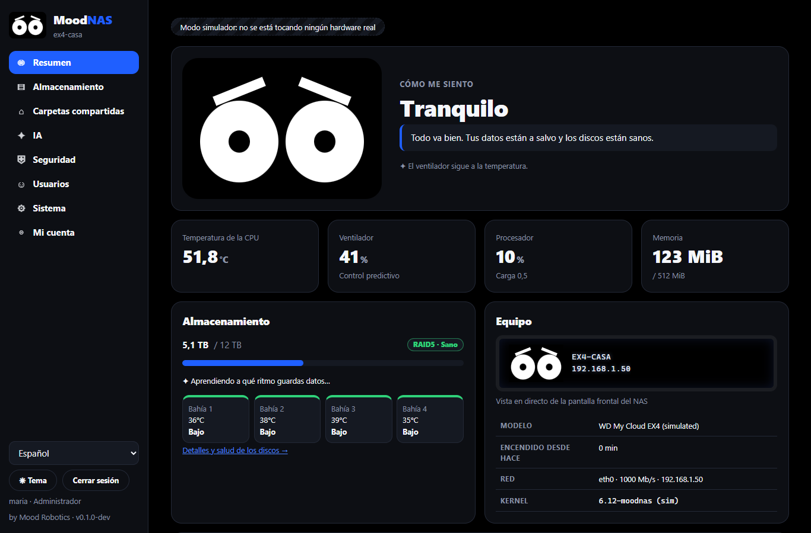

<p align="center">
  
</p>

<h1 align="center">MoodNAS</h1>

<p align="center">
  <strong>WD My Cloud EX4 に第二の人生を与える、新しいオープンソースファームウェア。<br>
  古いハードウェアに、最新のセキュリティと内蔵 AI を。</strong>
</p>

<p align="center">
  <a href="README.md">English</a> ·
  <a href="README.es.md">Español</a> ·
  <a href="README.pt.md">Português</a> ·
  <a href="README.fr.md">Français</a> ·
  <a href="README.de.md">Deutsch</a> ·
  <a href="README.it.md">Italiano</a> ·
  <a href="README.zh-CN.md">简体中文</a> ·
  <b>日本語</b>
</p>

<p align="center">
  
  
  
</p>

---

## なぜ MoodNAS なのか

**WD My Cloud EX4** は堅牢な 4 ベイ NAS ですが、Western Digital によるサポートはすでに終了しています。
最後のファームウェアは Linux 3.2（2013 年）、OpenSSL 1.0.1、PHP 5.4 で動作しており、
デフォルトの root パスワードが設定されたまま出荷されています。こうした機器が今も数多く、
ますます危険になるネットワーク上で、家族の写真や小規模ビジネスのファイルを保管しています。

**MoodNAS** は、そのファームウェアをモダンでオープンなシステムに置き換えます。
ハードウェアのあらゆる部分を活用し、古い ARM 機には想像もされていなかった機能を加えます。
それが、**あなたのデータを守る人工知能**です。

<p align="center">
  
</p>

## 主な特長

### 👀 気分を持つ NAS
Mood Robotics の目が MoodNAS の顔です。

- すべて順調なときは**穏やか**に。
- 作業中は**集中**して。
- 夜は**休息**。
- 注意が必要なことがあれば**心配**そうに。
- データが危険にさらされると、赤く光って**警戒**します。

同じ目が NAS の**前面 OLED ディスプレイ**にも表示されるので、
部屋の反対側からでも状態がひと目でわかります。

### 🧠 NAS 本体で動く AI
これらのモデルはクラウドを必要とせず、家の外に何も送信しません。

| | |
|---|---|
| **ディスク故障予測** | Backblaze が公開している故障統計に基づくモデルで、各ディスクの SMART データを分析します。故障が起きる前に、どのディスクが故障しそうか、そしてその理由を教えてくれます。 |
| **ランサムウェア監視** | ファイルの大量暗号化（エントロピー分析とリネームパターン）を検知し、**数秒以内に共有フォルダーを読み取り専用で凍結**します。 |
| **予測ファン制御** | 温度の傾向から発熱を先読みし、夜間は静かに動作します。安全性を損なうことは決してありません。 |
| **容量予測** | データが増えるペースを学習し、ボリュームがいっぱいになる数週間前に警告します。 |

### 💬 アシスタント「Mood」
普段の言葉で質問できます。*「NAS の調子はどう？」*、*「心配なディスクはある？」*、
*「全員が使える Photos という共有フォルダーを作って」*。Mood は **Claude**（Anthropic API）
または**ご自身のネットワーク上の Ollama** で動作するので、データを家の外に出さずに済みます。

- ツールが示す情報だけを参照し、変更はすべて**あなたの確認**を待ってから実行します。
- **プライバシー台帳**に、NAS の外へ送信されたすべてのリクエストが記録されます。

<p align="center">
  
</p>

### 🔒 設計段階からのセキュリティ
- **デフォルトパスワードなし。** 初回セットアップには、前面ディスプレイに表示されるワンタイムコードが必要です。
- **デフォルトで HTTPS。**
- **パスワード**は PBKDF2-SHA512 でハッシュ化。二要素認証（TOTP）とログイン試行の制限にも対応しています。
- **Web 保護：** CSRF 対策、厳格な Content-Security-Policy、監査ログ。
- **単一の静的 Go バイナリ**で、依存関係は最小限です。

詳しくは [SECURITY.md](SECURITY.md) をご覧ください。

### 🌍 あなたの言語で
インターフェースとドキュメントは**スペイン語、英語、ポルトガル語、フランス語、ドイツ語、
イタリア語、中国語、日本語**に対応しています。ユーザーごとに言語を選べます。

### 💾 データはそのまま
MoodNAS は WD のファームウェアで作成された RAID ボリュームを**そのまま**読み込みます。
フォーマットも移行も不要です。

## 開発状況

> **MoodNAS はアルファ版のソフトウェアです。** 完全なインターフェース、API、ローカル AI、
> アシスタントは、現在**シミュレートされた EX4** 上で動作しています。次のマイルストーンは
> 実機での起動です。ぜひご協力ください。

| フェーズ | | 状態 |
|---|---|---|
| 1 | ファームウェア解析、オープンな `wdfw` イメージツール（バイト単位で同一の再パッケージ） | ✅ 完了 |
| 2 | ハードウェア調査スクリプト（Stage 0、読み取り専用） | ✅ 準備完了、実機からのレポートを募集中 |
| 3 | Web UI（8 言語）、API、セキュリティ、シミュレーター | ✅ 完了 |
| 4 | デバイス上の AI + アシスタント（Claude / Ollama） | ✅ 初版 |
| 4b | 説明付きアラート、セマンティック検索、写真のタグ付け | 🔜 予定 |
| 5 | mainline カーネル + Buildroot、kexec ブート（フラッシュへの書き込みなし）、MCU ドライバー | 🚧 進行中：デバイスツリーの草案、MCU プロトコル解読済み |
| 6 | 恒久的なインストール | ⏳ シリアルコンソールによる復旧手段が必要 |

## 2 分で試す

Docker が必要です。

```sh
git clone https://github.com/moodrobotics/moodnas-wd-mycloud-ex4.git
cd moodnas-wd-mycloud-ex4
docker compose up --build
```

1. **http://localhost:8080** を開きます。
2. デモアカウント **`demo`** / **`moodnas-demo`** でログインします。
3. 概要ページでシミュレーターのシナリオ（熱波、故障しかけのディスク、RAID の縮退、
   ランサムウェア攻撃）を試してみてください。目の表情に注目です。

## 初回アクセスとパスワード

| 環境 | ユーザー名 | パスワード |
|---|---|---|
| デモ（`docker compose`、シミュレーター） | `demo` | `moodnas-demo` |
| 実機の NAS | **初期設定なし** | **初期設定なし** |

実機の NAS には**初期ユーザー名・初期パスワードはありません**。これは意図的な設計です。WD 純正ファームウェアには広く知られた root パスワードが設定されており、MoodNAS はその弱点を取り除きます。初回起動時は次のとおりです。

1. NAS の前面ディスプレイ（およびシステムログ）に 8 文字の**セットアップコード**が表示されます。
2. `https://<NAS の IP>` を開き、コードを入力します。これにより NAS のすぐそばにいることが証明され、ネットワーク上の他人が先に乗っ取ることはできません。
3. **ご自身の**管理者アカウントとパスワード（10 文字以上）を作成します。その後「マイアカウント」で二要素認証を有効にできます。

デモアカウントは `moodd -simulate -demo` のときだけ存在します。パスワードが公開されているため、`moodd` は実機では `-demo` を拒否します。

パスワードを忘れた場合のリセット手順は [docs/install](docs/install/README.md) を参照してください（ハードウェア移植とあわせて提供予定）。

## 仕組み

```
ブラウザー（Svelte、8 言語） ──HTTPS──▶ moodd（Go、単一の静的バイナリ）
                                        ├─ API · 認証 · 監査
                                        ├─ ローカル AI：ディスクリスク · 監視 · ファン · 予測
                                        ├─ アシスタント ─▶ Claude API | Ollama（LAN）
                                        └─ プラットフォーム ─▶ シミュレーター | EX4 ハードウェア（SATA、SMART、MCU、OLED）
```

| | |
|---|---|
| アーキテクチャ | [docs/architecture](docs/architecture/README.md) |
| AI の詳細 | [docs/ai](docs/ai/README.md) |
| ハードウェア | [docs/hardware](docs/hardware/README.md)：[ファームウェア形式](docs/hardware/firmware-format.md) · [前面パネル MCU プロトコル](docs/hardware/mcu-protocol.md) |
| インストール計画と Stage 0 | [docs/install](docs/install/README.md) |

## ハードウェア

| | WD My Cloud EX4 |
|---|---|
| SoC | Marvell Armada 300 / Kirkwood 88F6282、ARMv5TE、ハードウェア暗号化対応 |
| RAM | 512 MB |
| ベイ | 4 × 3.5" SATA |
| ネットワーク | 2 × ギガビットイーサネット |
| 前面パネル | OLED ディスプレイ、ボタン、ファン（マイクロコントローラーで制御） |

その他の WD モデル（EX2、EX4100、PR4100）にはまだ対応していません。
コントリビューションを歓迎します。

## コントリビューション

今いちばん役立つのは、実機の EX4 から取得した
**[Stage 0 レポート](docs/install/README.md#stage-0-hardware-inventory)** です。
読み取り専用で、フラッシュのバックアップも同時に作成されます。開発や翻訳については
[CONTRIBUTING.md](CONTRIBUTING.md) をご覧ください。

## 法的事項

MoodNAS は [GNU GPL v3.0 以降](LICENSE)のもとで提供されるフリーソフトウェアです。
**Mood Robotics** による独立したプロジェクトであり、Western Digital とは提携関係になく、
同社による承認やサポートも受けていません。「WD」および「My Cloud」は Western Digital
Corporation の商標であり、ここではハードウェアの互換性を説明する目的でのみ使用しています。
このリポジトリには Western Digital のファームウェアやバイナリは一切含まれていません。
ツールは、ご自身でダウンロードしたファイルに対して動作します。

デバイスのファームウェアの置き換えにはリスクが伴います。MoodNAS は無保証で提供されます。
必ず事前にデータをバックアップしてください。

<p align="center"><sub>Mood Robotics が ♥ を込めて制作：古いハードウェアにも、新しい知性を。</sub></p>
